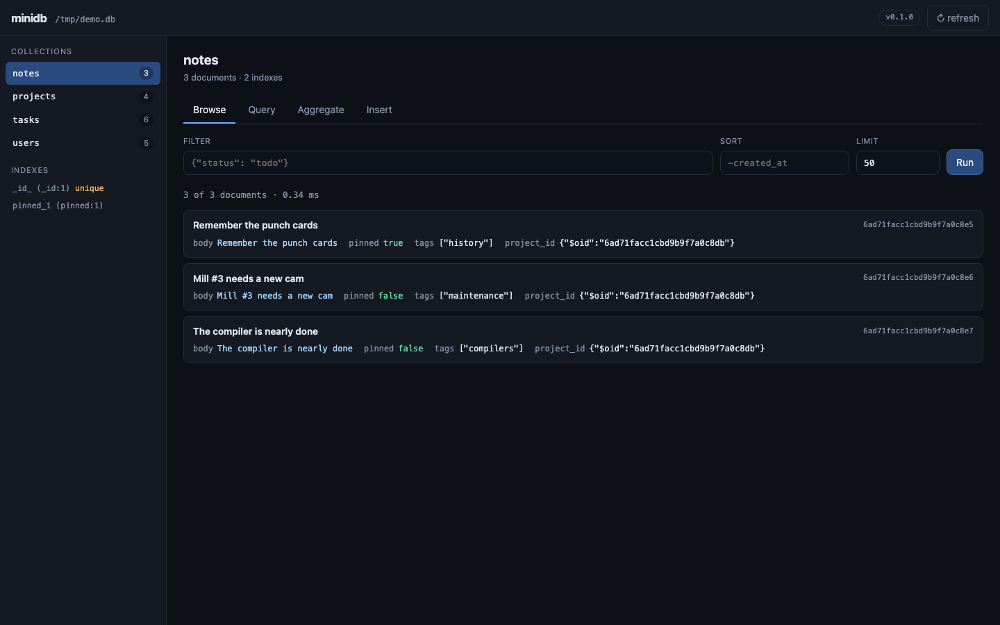

# minidb

[](https://github.com/V1PASH/Database/actions/workflows/ci.yml)
[](https://www.python.org/)
[](LICENSE)

**A MongoDB-style document database, written from scratch.**

You asked for a database of your own that behaves like MongoDB. This is one:
a document store with a real query engine, its own index structures, its own
aggregation pipeline and schema validation -- built on top of SQLite for
durability, but with none of MongoDB's behaviour handed to you for free.

The API is deliberately shaped like PyMongo's, so application code written
against minidb keeps working if you ever point it at a real MongoDB server.

```python
from minidb import Database

db = Database("app.db")
db.create_collection("users", validator={"required": ["name", "email"]})

db.users.insert_one({"name": "Ada", "email": "ada@example.com", "role": "admin"})
db.users.find_one({"email": "ada@example.com"})
db.users.update_one({"name": "Ada"}, {"$inc": {"logins": 1}})
db.users.create_index("email", unique=True)
```

---

## Is it really MongoDB-compatible?

Rather than guess, minidb is tested **against a real MongoDB server**. Every
filter, update and pipeline in `tests/test_parity.py` is executed against
both databases and the results compared:

```
$ pytest tests/ -q
163 passed
```

That suite is what pinned down the subtle parts of MongoDB's behaviour --
for example, that range operators *type bracket* (a `null` field never
matches `{"age": {"$lt": 36}}`), that `$min`/`$max` ignore nulls, and that
`$addToSet` ordering is deliberately unspecified.

If you have MongoDB running locally, the parity tests use it. Without it,
they skip and the rest of the suite still runs.

---

## Getting started

```bash
pip install minidb-db            # from PyPI
pip install -e ".[dev]"           # from a clone, with the test tools
```

Then:

```bash
python -m app.demo          # a guided tour of the example app
python -m bench.benchmark   # what indexes buy you
pytest tests/ -q            # the test suite
minidb-ui app.db            # browse the database in your browser
```

The import name is `minidb`, whatever the package is called:

```python
from minidb import Database

db = Database("app.db")
db.users.insert_one({"name": "Ada", "email": "ada@example.com"})
```

The package has **no runtime dependencies** -- it is pure Python on top of
the standard library's `sqlite3`.

---

## What is in the box

| Area | What works |
|---|---|
| **Documents** | JSON documents with `ObjectId`, `datetime`, `Decimal`, `UUID` and `bytes` support |
| **Queries** | `$eq` `$ne` `$gt` `$gte` `$lt` `$lte` `$in` `$nin` `$exists` `$regex` `$options` `$all` `$size` `$elemMatch` `$not` `$type` `$mod`, plus `$and` `$or` `$nor` |
| **Paths** | Dotted paths (`"address.city"`), implicit traversal into arrays |
| **Updates** | `$set` `$unset` `$inc` `$mul` `$min` `$max` `$push` `$addToSet` `$pop` `$pull` `$pullAll` `$rename` `$setOnInsert` `$currentDate`, `arrayFilters`, upserts, replacements |
| **Aggregation** | `$match` `$project` `$addFields`/`$set` `$unset` `$group` `$sort` `$limit` `$skip` `$count` `$unwind` `$replaceRoot` `$sortByCount` and ~30 expressions |
| **Schemas** | Per-collection validators: types, `required`, `enum`, `pattern`, numeric bounds, array rules, `additionalProperties`, and **`default` values** |
| **Indexes** | Single-field and **compound** indexes (unique or not), multikey (array) indexes, order-preserving keys that serve equality *and* range lookups |
| **Writes** | Transactions with rollback, unique-constraint enforcement, `ObjectId` generation |
| **Extras** | `explain()` to see the query plan, `distinct()`, `count_documents()`, cursors with `sort`/`skip`/`limit` |

---

## How it works

```
            your app
               |
        minidb/collection.py     the API (PyMongo shaped)
               |
    +----------+-----------+-------------------+
    |          |           |                   |
 query.py  update.py  aggregation.py    validation.py
    |          |           |                   |
    +----------+-----------+-------------------+
               |
          index.py         the planner + the key encoding
               |
         engine.py          SQLite: documents, index tables, transactions
               |
           SQLite file
```

**Storage.** Documents are stored as JSON text, one row per document, keyed
by `(collection, id)`. SQLite gives durability, atomicity and crash safety
for free -- but every decision that defines *how the database behaves*
lives in this project, not in SQLite.

**Indexes.** minidb keeps its own index tables (`_minidb_index_entries`),
keyed by `(collection, index, encoded_key, document_id)` and stored
`WITHOUT ROWID`, so SQLite's B-tree does the work. The encoding is
**order preserving**: a value is mapped onto bytes whose byte order matches
MongoDB's BSON comparison order, which is what lets one index serve both
equality lookups and range scans. Each component of a key is
self-delimiting, so a compound key's components are compared one after the
other.

**The planner.** `index.py` looks at the filter, finds an indexed field it
can use, and hands the engine a plan (`eq`, `prefix` or `range`). The engine
then returns a *candidate set* -- always a **superset** of the matching
documents -- and the full filter is applied in Python afterwards. That
last step is what keeps the answers correct: an index may be an
approximation, but it can never change the result.

**Type ordering.** MongoDB compares values of different types using a fixed
order (null < numbers < strings < objects < arrays < ... < dates). minidb
reproduces that in `comparison.py`, which is why `{"a": {"$gt": 5}}` behaves
the same in both.

---

## Using it

### Reading

```python
db.users.find_one({"email": "ada@example.com"})
db.users.find({"age": {"$gte": 30}}, sort=[("age", -1)], limit=10)
db.users.find({"address.city": "London"}).sort("name").skip(20)

db.users.find_one({"name": "Ada"}, {"name": 1, "email": 1, "_id": 0})
```

### Writing

```python
db.users.insert_one({"name": "Ada", "email": "ada@example.com"})
db.users.insert_many([...])

db.users.update_one({"_id": oid}, {"$set": {"role": "admin"}, "$inc": {"logins": 1}})
db.users.update_many({"role": "viewer"}, {"$set": {"active": False}})
db.users.replace_one({"_id": oid}, {"name": "Ada", "email": "a@b.com"})

db.users.update_one(
    {"_id": oid},
    {"$set": {"items.$[i].done": True}},
    array_filters=[{"i.qty": {"$gte": 2}}],
)
```

### Aggregating

```python
list(db.tasks.aggregate([
    {"$match": {"project_id": project_id}},
    {"$group": {"_id": "$assignee_id", "hours": {"$sum": "$estimate_hours"}}},
    {"$sort": {"hours": -1}},
]))
```

### Schemas

```python
db.create_collection("users", validator={
    "required": ["name", "email"],
    "additionalProperties": False,
    "properties": {
        "name": {"type": "string", "minLength": 1},
        "email": {"type": "string", "format": "email"},
        "role": {"type": "string", "enum": ["admin", "member"], "default": "member"},
    },
})
```

A document that breaks the schema is rejected on write, with a message
pointing at the offending field. `default` values are filled in for you.

### Indexes

```python
db.users.create_index("email", unique=True)
db.tasks.create_index([("project_id", 1), ("status", 1)])   # compound
db.users.list_indexes()
db.users.explain({"email": "ada@example.com"})
```

```
{'strategy': 'IXSCAN', 'index': 'email_1', 'documentsExamined': 1, 'totalDocuments': 20000}
```

A **compound index** covers several fields. Its key is the concatenation of
self-delimiting component keys, so the components are compared one after
the other -- exactly like MongoDB, whose compound keys are compared
component by component. That is what lets one index answer:

| Query | What the index does |
|---|---|
| `{"a": 1, "b": 2}` | exact key lookup |
| `{"a": 1}` | prefix scan |
| `{"a": 1, "b": {"$gt": 5}}` | one contiguous range of keys |
| `{"b": 2}` | not usable -- `a` comes first, so the index cannot help |

On 20,000 documents, a compound index turned a 55.9 ms scan into a
0.01 ms lookup.

---

## The web UI

Every database deserves a way to look at it. minidb ships with one:

```bash
minidb-ui app.db            # or: python -m minidb.webui app.db
```

No data yet? Seed a sample database first:

```bash
python -c "from minidb import Database; from minidb.demo import seed; seed(Database('demo.db'))"
minidb-ui demo.db
```



It opens on `http://127.0.0.1:8080` and gives you:

- **Browse** -- every collection with its document count, its indexes, and a
  filter/sort/limit toolbar
- **Query** -- a filter, a projection, a sort, a limit and a skip
- **Aggregate** -- a whole aggregation pipeline
- **Insert** -- a document, validated by the collection's schema
- **Document detail** -- click any document for highlighted JSON, and delete
  it from there

The server is built on `http.server` from the standard library, so it has no
dependencies of its own. It binds to localhost and has **no authentication**:
it is a local development tool, not something to expose to a network.

---

## The example application

`app/` is a small but complete backend built on the database:

| File | What it holds |
|---|---|
| `schemas/collections.py` | The schemas for `users`, `projects`, `tasks`, `notes` |
| `app/database.py` | Opening the database, creating collections and indexes |
| `app/repositories.py` | The access layer the application actually uses |
| `app/demo.py` | A runnable tour (`python -m app.demo`) |

Keeping every database call inside the repositories means the storage
engine can be swapped later without touching the rest of the app -- swap
`minidb.Database` for `pymongo.MongoClient` and the repositories keep
working.

---

## Differences from MongoDB (the honest list)

minidb is a from-scratch implementation, so some things are missing or
behave differently. Everything here is a deliberate limitation, not a bug:

**Not implemented**

- Descending index directions -- compound indexes are ascending only, and
  `create_index` says so rather than quietly ignoring the direction.
- `$lookup`, `$facet`, `$out`, `$merge`, `$graphLookup`, `$unionWith`.
- The positional `$` operator in updates (`"items.$.qty"`). `arrayFilters`
  (`"items.$[i].qty"`) do work.
- Change streams, geospatial queries, full-text search, map/reduce.
- A network protocol: minidb is an embedded library, not a server.
- Replication, sharding, and transactions spanning collections.

**Different on purpose**

- `find()` returns documents in insertion order, and sorting ties keep
  insertion order. MongoDB does not promise an order for ties.
- `$addToSet` keeps insertion order; MongoDB's order is unspecified.
- `additionalProperties: False` exempts `_id`, which minidb adds itself.
- The `_id` index is always present; there is no way to drop it.
- A document with several very large array fields in one compound index
  needs too many key combinations to index completely. minidb keeps the
  document findable through an overflow table rather than hiding it.

---

## Continuous integration

Every push runs the suite on Python 3.11, 3.12 and 3.13 -- against a real
MongoDB service, so the parity tests actually run rather than skipping
themselves. The browser code is checked under node, and the package is
built, checked with `twine` and installed into a clean environment.

Releasing to PyPI is one tag away, once the repository is registered as a
trusted publisher on PyPI:

```bash
git tag v0.1.0 && git push origin v0.1.0
```

---

## Where to take it next

The interesting problems in a database are all still open here:

1. **Descending index directions** -- a compound key whose components can
   each be scanned backwards, and a planner that uses them for reverse sorts.
2. **A real storage engine** -- replace the SQLite file with a write-ahead
   log, free-space reuse and page-level compaction.
3. **Concurrency** -- MVCC with snapshot isolation instead of a single
   write lock.
4. **A server** -- a wire protocol and a client library, so minidb can be
   used from another language.
5. **A better planner** -- cost estimates, index intersection, and choosing
   between several usable indexes.
6. **Full-text search** -- an inverted index over tokenised documents.

---

## Layout

```
minidb/          the database
  collection.py    the API
  query.py         filter semantics
  update.py        update operators
  aggregation.py   the pipeline
  validation.py    schemas
  index.py         key encoding + planner
  engine.py        SQLite storage layer
  comparison.py    BSON value ordering
  bson.py          document codec
  objectid.py      ObjectId
  database.py      the Database object
  demo.py          sample data
  webui/           the web UI (stdlib only)
    server.py        the HTTP API
    static/          the browser app
schemas/         the example app's schemas
app/             the example app
bench/           benchmarks
docs/            the screenshot
tests/
  test_minidb.py    unit tests
  test_parity.py    minidb vs. real MongoDB
  test_webui.py     the web UI's API
  frontend_smoke.mjs  the browser code, in a DOM shim
```
